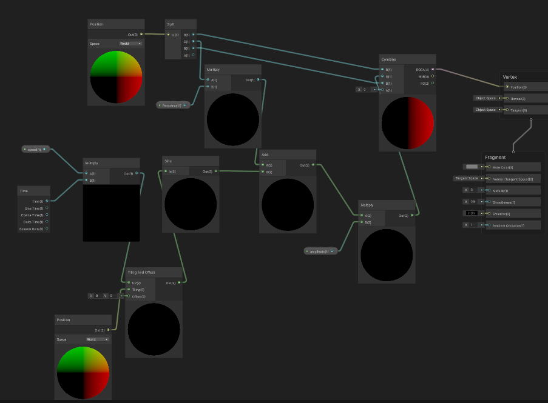

# graphicstutorial8

I created a sine wave shader and added a tiling and offset to a position, and turned up the speed of the sine wave, making it look like whatever the material is attached to is boiling.

